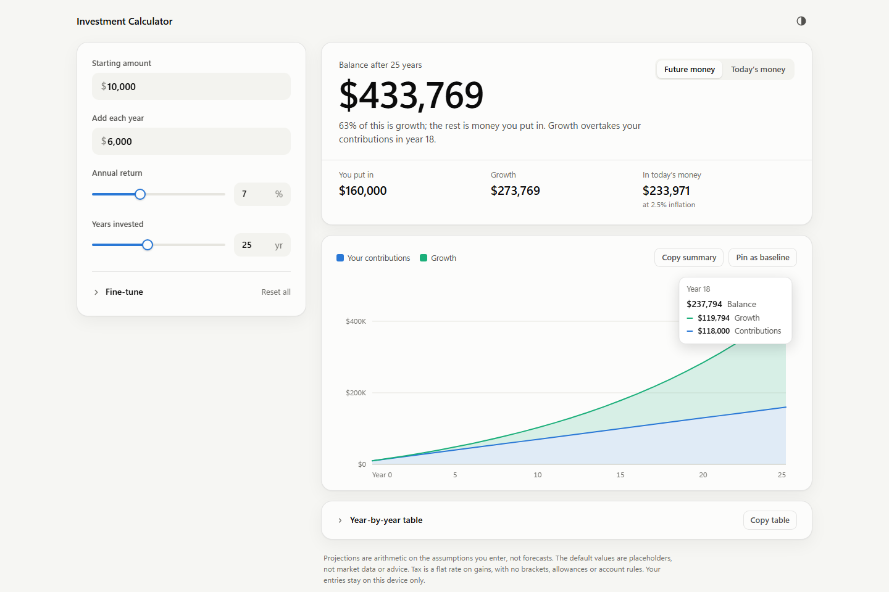
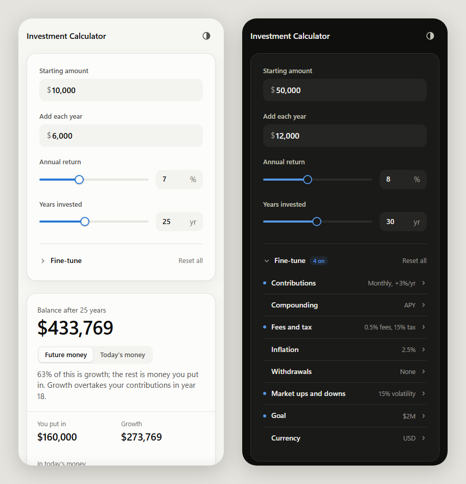
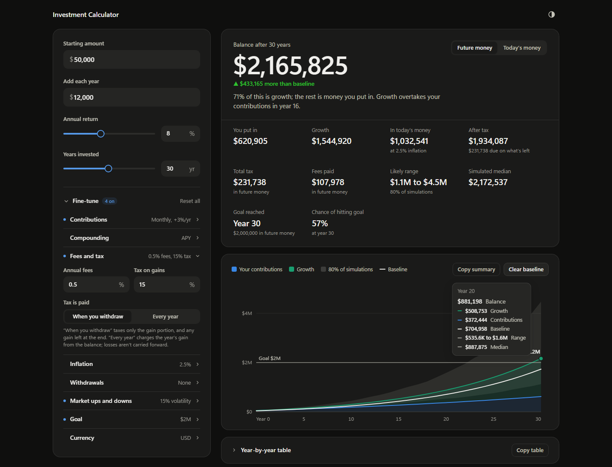

# Investment Calculator

See what an investment could grow to. Enter a starting amount, a yearly addition, a return and a number of years for an instant answer. Open **Fine-tune** to model fees, tax, inflation, withdrawals, a target balance or uneven market years.

**[Open the calculator →](https://samcky2k-git.github.io/investment-calculator/)**

It's free, needs no account and works offline once installed. Nothing you type leaves your device.



## Put it on your phone

It installs like an app, with its own icon, no browser bars, and offline use after the first visit.

- **iPhone:** open the link in **Safari**, tap **Share**, then **Add to Home Screen**.
- **Android:** open the link in **Chrome**, tap the **⋮** menu, then **Add to Home screen** or **Install app**.



## What you can adjust

The four main inputs are always visible. Everything else sits under **Fine-tune**, collapsed until you need it.

| Setting | Options |
|---|---|
| Contributions | Paid yearly, quarterly, monthly, every two weeks or weekly, at the start or end of each period. Raise them by a set % each year, or stop after a chosen year. |
| Compounding | A true annual return (APY), or a stated rate (APR) compounded monthly, quarterly or daily. |
| Fees and tax | An annual fee %. Tax on gains, paid either when you withdraw or every year. |
| Inflation | Drives the **Today's money** figures. |
| Withdrawals | A yearly amount from a chosen year, optionally raised with inflation. You'll see a warning if the money runs out. |
| Market ups and downs | Simulates 1,000 random market histories and shows the range covering the middle 80% of outcomes. |
| Goal | A target balance. Shows the year you reach it, or the yearly addition or return you'd need. |
| Currency | USD, EUR, GBP, CAD or AUD. This changes the symbol only. |

Other tools:
- **Future money / Today's money:** switches every figure to inflation-adjusted values.
- **Pin as baseline:** keeps the current scenario on the chart, so each change shows the difference in dollars.
- **Copy summary:** copies the scenario and results as text, ready to paste into a message.
- **Year-by-year table:** **Copy table** pastes into Excel or Numbers as columns.



## How the numbers are worked out

The calculator steps through each payment period. The period rate comes from the true annual rate, (1 + r)^(1/n) − 1, so switching contributions to monthly doesn't quietly change the return.

- **Fees** come off the balance every period, at the yearly % spread evenly across periods.
- **Tax when you withdraw:** each withdrawal is taxed only on its share of gain. Any gain left at the end is shown as tax due, in the **After tax** figure.
- **Tax every year:** each year's gain is taxed from the balance. Losses aren't carried forward.
- **Withdrawals** take a proportional share of what you put in and what it earned. Contributions stop once withdrawals begin.
- **Today's money** divides by (1 + inflation)^years. Contributions are valued at when you paid them in.
- **Simulation:** each year's return is drawn independently from a lognormal distribution. Its median is your entered return and its standard deviation is your volatility setting. The draws are seeded, so the same inputs always give the same range.

These are deliberate simplifications. Tax is a flat rate on gains, with no brackets, allowances or account rules such as 401(k), IRA, ISA or Roth. Real markets have fat tails and runs of bad years that independent draws don't capture, so treat the simulated range as a rough guide.

**The default inputs are placeholders, not market data or advice.** A projection is arithmetic on the assumptions you enter, not a forecast.

## Privacy

Everything runs in your browser. There are no accounts, analytics, cookies or servers involved. Your inputs are saved on your own device so they're still there next time, and they're never uploaded. People you share the link with start from the defaults and see only their own numbers.

## For developers

| Path | Purpose |
|---|---|
| `index.html` | The whole app in one file, and the single source for everything else. It also opens directly from disk. |
| `build-web.js` | Builds `docs/`, the installable site with its manifest, icons and offline worker. Also builds `web/`, the claude.ai Artifact version. |
| `make-icons.js` | Renders `icon.svg` to the PNG icons in `icons/`. Needs Google Chrome. |
| `tests/engine.test.js` | Checks the calculations against closed-form results. |
| `docs/` | The published site. GitHub Pages serves this folder, so don't edit it by hand. |

To update the site:

```
node tests/engine.test.js   # check the maths
node build-web.js           # rebuild docs/ and web/
git add -A && git commit -m "Describe the change" && git push
```

GitHub Pages republishes within a minute or two. Installed copies pick up the new version on the next launch after that, because each build gets a fresh offline cache.

The app needs Node.js to build, and no packages to install.
